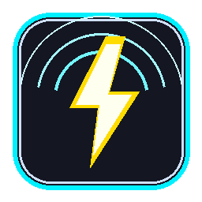

# ⚡ 100-Clicks Mouse Burst Multiplier — Cyber Elite Edition

<div align="center">



### *Hyper-Speed Hardware-Level Mouse Multiplier & Autoclicker for Windows*

[](https://www.python.org/)
[](https://microsoft.com/windows)
[](https://github.com/TomSchimansky/CustomTkinter)
[](LICENSE)
[](100ClicksBurst.exe)

**Turns 1 physical mouse click into 100 rapid clicks automatically in any game, desktop software, or browser.**

</div>

---

## 🌟 Highlights & Features

- **🚀 1 Click = 100 Clicks**: Instantly fires 100 rapid synthetic clicks at hardware speed on physical mouse press or hotkey.
- **🎨 Cyber Elite Dark UI**: Built with CustomTkinter featuring glowing neon elements, high-contrast text, and Windows 11 Fluent styling.
- **🎆 60 FPS Particle Physics Arena**: An interactive testing zone inside the app with neon spark explosions, expanding shockwave rings, and live CPS measurement.
- **⚡ 1ms Precision Multimedia Engine**: Powered by `winmm.timeBeginPeriod(1)` and native Win32 `mouse_event` for ultra-consistent click registration in games (Roblox, Minecraft, Unity, Unreal Engine, clicker games).
- **🖱️ Multi-Button Targeting**: Easily switch between **Right Click** (Default), **Left Click**, or **Middle Click**.
- **🎛️ Click Presets & Speed Slider**: Quick-select presets (`50`, `100`, `250`, `500`, `1000`) and customizable delay down to 1ms (350+ CPS).
- **🛑 Safety & Anti-Runaway Debounce**: Automatic physical button release detection prevents unwanted infinite click loops.
- **📦 Zero-Install Standalone Executable**: Pre-compiled single `.exe` with embedded icon included.

---

## ⌨️ Global Shortcuts & Hotkeys

| Shortcut | Function | Description |
|---|---|---|
| **`Right Click`** | **Burst Trigger** | Fires 100 rapid clicks automatically *(configurable to Left or Middle click)* |
| **`F8`** | **Instant Burst** | Fires 100 clicks right at your current cursor without clicking your mouse |
| **`F6`** | **Toggle Active / Pause** | Instantly enable or disable burst mode (with audio chime confirmation) |
| **`ESC`** | **Emergency Stop** | Immediately halts any active click stream and pauses the engine |

---

## 🚀 Quick Start (No Python Required)

1. Clone or download this repository:
   ```bash
   git clone https://github.com/damsarachethiyaa-dev/100-clicks-mouse-burst.git
   cd 100-clicks-mouse-burst
   ```
2. Run the standalone executable:
   * Double-click [**`100ClicksBurst.exe`**](100ClicksBurst.exe)
   * *(Optional: Double-click [**`Run_As_Administrator.bat`**](Run_As_Administrator.bat) if using inside games with elevated anti-cheat like Roblox or Minecraft).*

---

## 🛠️ Running from Source

Requirements: Python 3.10+ on Windows.

1. Install dependencies:
   ```bash
   pip install -r requirements.txt
   ```
2. Launch the application:
   ```bash
   python burst_clicker.py
   ```
3. To rebuild the standalone `.exe`:
   ```bash
   python -m PyInstaller --onefile --noconsole --icon=app_icon.ico --collect-all customtkinter --name="100ClicksBurst" burst_clicker.py
   ```

---

## 📂 Project Structure

```
├── 100ClicksBurst.exe      # Compiled standalone Windows executable (Ready to run)
├── burst_clicker.py        # Main Python source code with CustomTkinter & Canvas engine
├── burst_clicker.ahk       # Alternative AutoHotkey script (v1/v2 compatible)
├── app_icon.ico            # High-resolution multi-size Windows icon
├── app_icon.png            # PNG logo asset
├── test_clicks.html        # Interactive browser click test page
├── Start_100Clicks.bat     # One-click Windows batch launcher
├── Run_As_Administrator.bat# Elevated launcher for protected games
├── requirements.txt        # Python package dependencies
├── .gitignore              # Git ignore rules
├── LICENSE                 # MIT License
└── README.md               # Documentation
```

---

## 🧪 Browser Testing Arena

Open [**`test_clicks.html`**](test_clicks.html) in any web browser to test your click bursts with live counters and CPS gauges!

---

## 📄 License

This project is licensed under the [MIT License](LICENSE).
